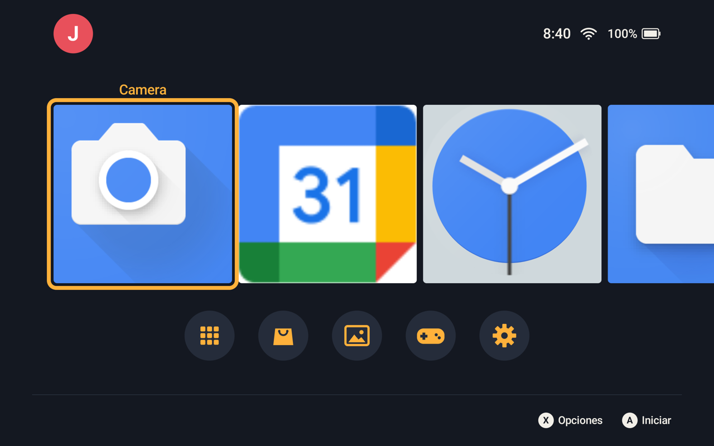
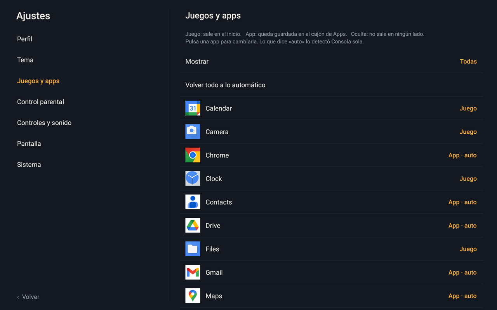
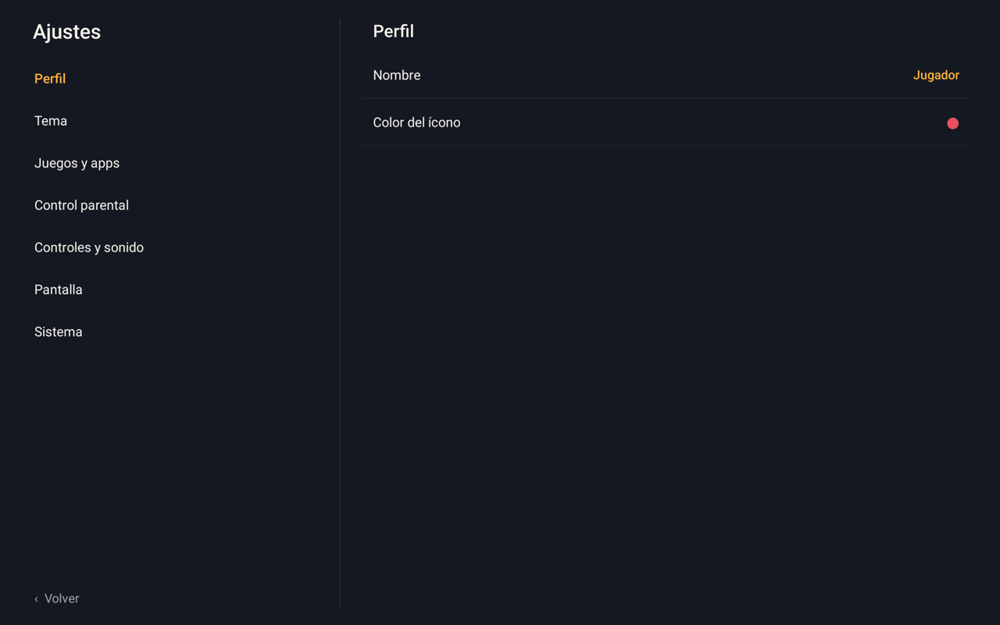

# Consola

Launcher estilo consola portátil para Android: tus juegos en una fila grande, las apps guardadas aparte y las que quieras, ocultas tras un PIN.



## Características

- **Inicio con fila de juegos**: los 12 juegos usados más recientemente, con su ícono convertido en portada cuadrada a sangre, y un acceso a la lista completa de juegos.
- **Botones redondos** para Apps, Tienda, Capturas, Controles y Ajustes, todos con el mismo color de acento.
- **Tres lugares para cada app**: *Juego* (sale en el inicio), *App* (queda en el cajón de Apps) u *Oculta* (no sale en ningún lado). La detección es automática (`CATEGORY_GAME` o emuladores conocidos) y se puede cambiar a mano.
- **Control parental con PIN** (guardado como hash SHA-256) para el cajón de Apps, la Tienda y los Ajustes.
- **Se maneja con mando, teclado o táctil**: cruceta/stick para moverse, A abre, B vuelve, X o + muestra opciones, L/R saltan. Opción para intercambiar A/B.
- **Tema oscuro (azul noche) y claro (crema) con acento ámbar**, orientación horizontal, vertical o automática, sonidos de interfaz sintetizados (sin archivos de audio) y vibración.
- **Ligero**: Kotlin puro con vistas dibujadas en `Canvas`, sin AndroidX ni dependencias externas.

| Juegos y apps | Ajustes |
|---|---|
|  |  |

## Requisitos

- Android 10 (API 29) o superior.
- Para compilar: JDK 17 y Android SDK (compileSdk 35). Gradle se descarga solo con el wrapper incluido.

## Compilar

Crea `local.properties` con la ruta de tu Android SDK (Android Studio lo hace solo):

```properties
sdk.dir=/ruta/a/Android/Sdk
```

Linux / macOS:

```bash
export JAVA_HOME=/ruta/a/jdk-17
./gradlew assembleDebug
```

Windows (PowerShell):

```powershell
$env:JAVA_HOME = "C:\Program Files\Eclipse Adoptium\jdk-17..."
.\gradlew.bat assembleDebug
```

El APK queda en `app/build/outputs/apk/debug/app-debug.apk`.

## Instalar

```bash
adb install -r app/build/outputs/apk/debug/app-debug.apk
```

Luego pulsa el botón de Inicio del teléfono y elige **Consola** → «Siempre» (o en Ajustes de Android ▸ Apps ▸ App de inicio predeterminada).

Para volver al launcher anterior, elígelo en esa misma opción y desinstala con:

```bash
adb uninstall pa.jorshua.consola
```

## Límites conocidos

- Un launcher no puede bloquear la barra de notificaciones ni la vista de apps recientes: el control parental sirve para que las apps no estén a la vista, no es un candado total. Para eso, combínalo con «Fijar aplicación» o con un control parental del sistema.
- Usa el permiso `QUERY_ALL_PACKAGES` (necesario para listar todas las apps), por lo que está pensado para instalarse directamente, no para Google Play.

## Licencia

[MIT](LICENSE) © 2026 Jorshua Jiménez
